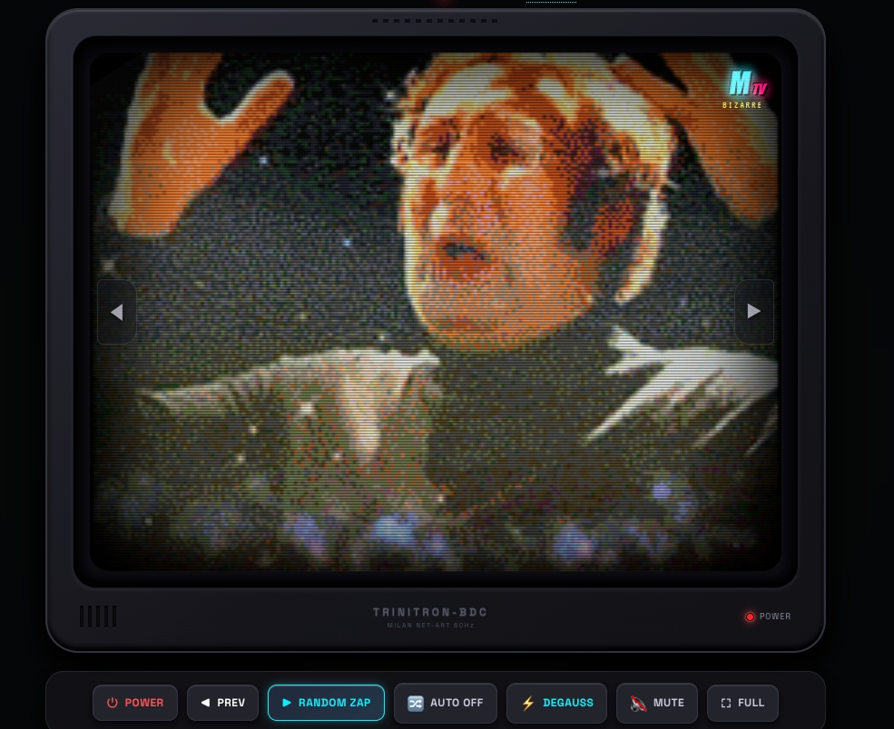

# 📺 GIF-TV // Net Art CRT Television

> Un televisore a tubo catodico (CRT) vintage a fosfori che trasmette un canale unico infinito di GIF assurde, surrealismo e loop underground in puro stile **MTV Liquid Television** (anni '90).

<p align="center">
  
</p>

---

## ⚡ Caratteristiche

- **Simulatore CRT a Fosfori**: Curvatura dello schermo (*barrel distortion*), scanlines orizzontali in deriva continua, maschera subpixel RGB e riflessi su vetro bombato.
- **Degauss Magnetico (`D`)**: Scossa elastica a 60Hz con aberrazione cromatica arcobaleno e scarica sub-bass ("BWWOOOOOMP").
- **Collasso Catodico (`P`)**: Animazione realistica di spegnimento a linea laser e punto di fosforo centrale.
- **Flusso Infinito Random**: Grabbing online continuo di GIF assurde, weirdcore, cyber-glitch e bumper sperimentali con preloading e cronologia navigabile.
- **Audio Procedurale (Web Audio API)**: Zero file MP3 scaricati: rumore bianco di sintonia, click meccanici e ronzio flyback sintetizzati matematicamente dal browser in tempo reale.
- **Architettura Leggera**: 100% Vanilla Web (HTML5/CSS3/ES6+), zero librerie esterne, PWA offline ready.

---

## 🎮 Controlli Rapidi

| Tasto / Gesto | Azione |
| :--- | :--- |
| `◀` / `▶` o `←` `→` `↑` `↓` | Zapping random / GIF precedente |
| `Spazio` o Click su TV | Prossima GIF random |
| `D` | Degauss magnetico coil |
| `Z` | Auto Zapping ogni 7 secondi |
| `M` | Audio analogico On / Off |
| `P` | Power CRT On / Off |
| `F` | Schermo Intero (*Gallery Installation*) |

---

## 🚀 Avvio Locale

Apri direttamente `index.html` nel browser, oppure lancia un server locale:

```bash
python3 -m http.server 8080
```
Apri `http://localhost:8080`.

---

<p align="center">
  Made with ♥ in Milan by <a href="https://emaf205.com" target="_blank" rel="noopener"><strong>EmaF205</strong></a>
</p>
